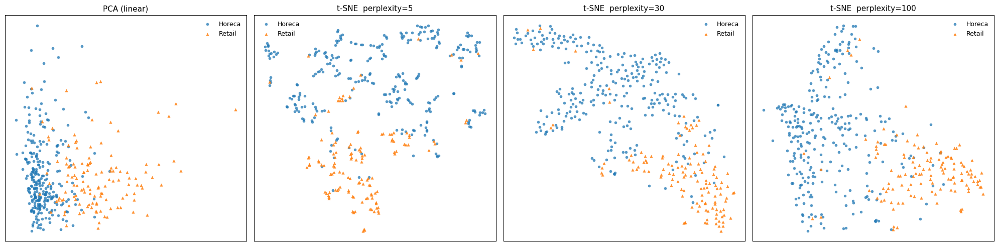
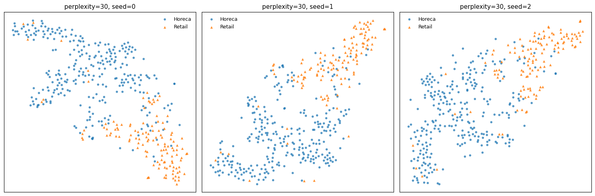

# t-SNE do zero em NumPy

Implementação do t-SNE sem sklearn, aplicada ao dataset Wholesale Customers (UCI)
e comparada com PCA.

Continuação de [kmeans-vs-gmm-wholesale](https://github.com/nei-jr/kmeans-vs-gmm-wholesale).



## O que foi implementado
- Busca binária de σᵢ para atingir a perplexidade alvo
- Simetrização das afinidades: p_ij = (p_j|i + p_i|j) / 2N
- Distribuição t (ν = 1) no espaço de baixa dimensão
- Early exaggeration, momentum e ganhos adaptativos

## Resultados
Acurácia de 5-NN (validação cruzada, 5 folds) para separar Horeca vs Varejo:

| Representação            | Acurácia |
|--------------------------|----------|
| PCA 2D                   | 0,868    |
| t-SNE (perplexidade 5)   | 0,892    |
| t-SNE (perplexidade 30)  | 0,887    |
| t-SNE (perplexidade 100) | 0,897    |
| 6 dimensões originais    | 0,907    |

## Sensibilidade à semente
Com perplexidade 30, três inicializações diferentes geram mapas diferentes
na forma, mas com a mesma estrutura de vizinhança:



## Observações
- O KL não é comparável entre perplexidades (cada uma define uma matriz P diferente).
- No t-SNE, distâncias entre clusters e tamanhos de cluster não têm significado.
- O t-SNE não projeta pontos novos, diferente do PCA.

## Como rodar
```
pip install numpy pandas scipy matplotlib scikit-learn
```

Abra `tsne.ipynb` e execute todas as células.
O arquivo `Wholesale customers data.csv` já está no repositório.

## Referência
Murphy, K. P. *Probabilistic Machine Learning: An Introduction*. MIT Press, 2022. Cap. 20.

## Dados
[Wholesale Customers – UCI](https://archive.ics.uci.edu/dataset/292/wholesale+customers)
